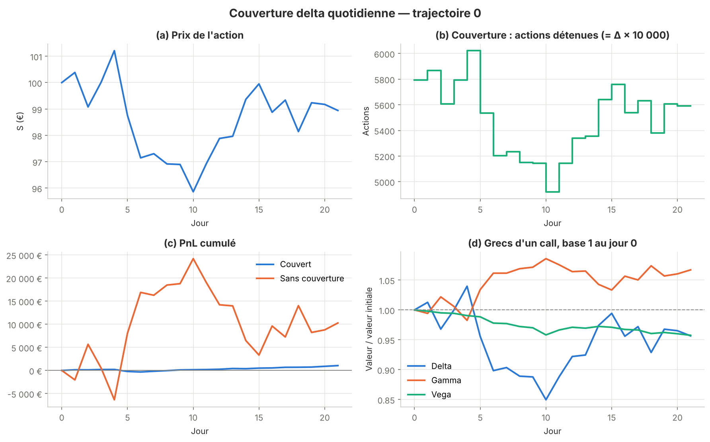
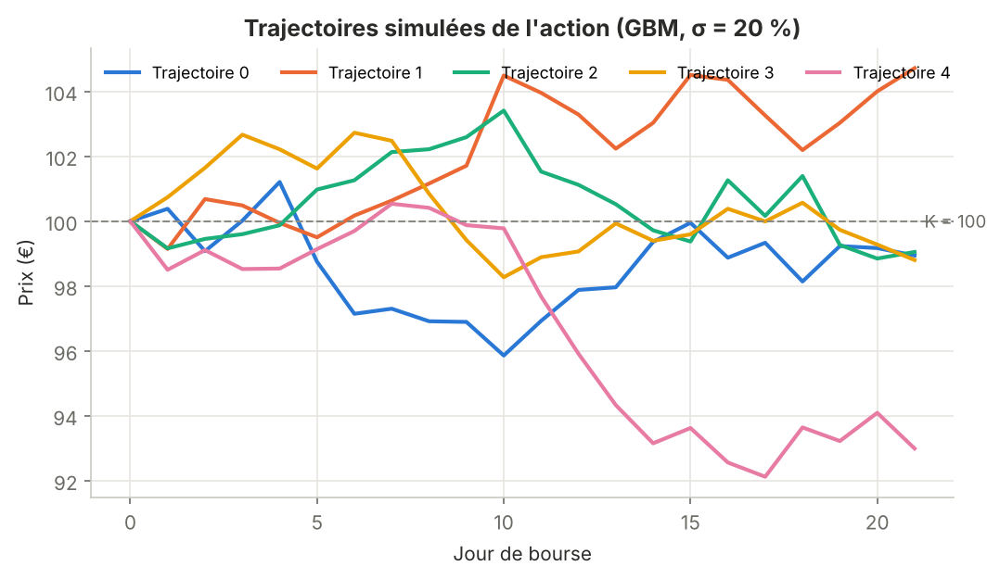
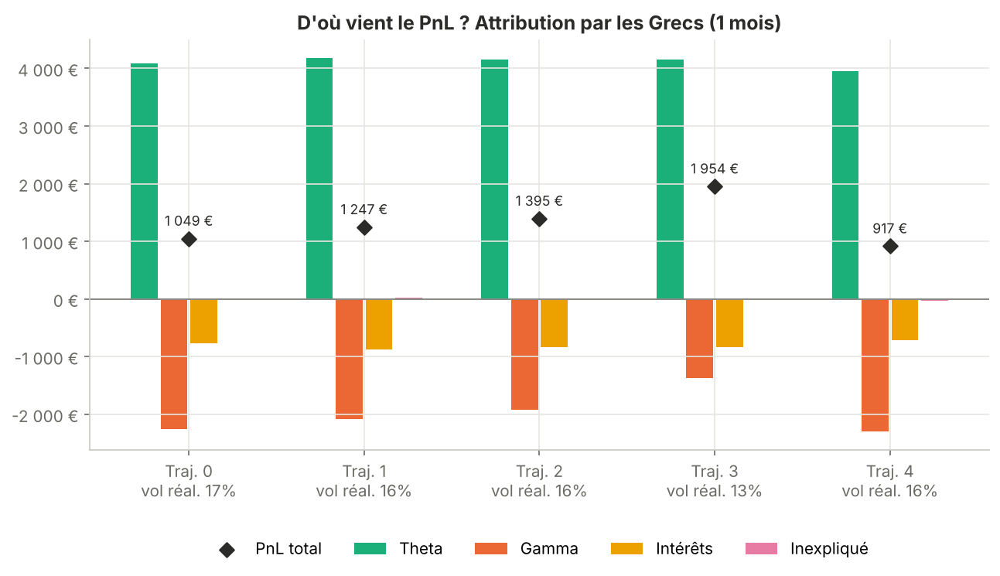
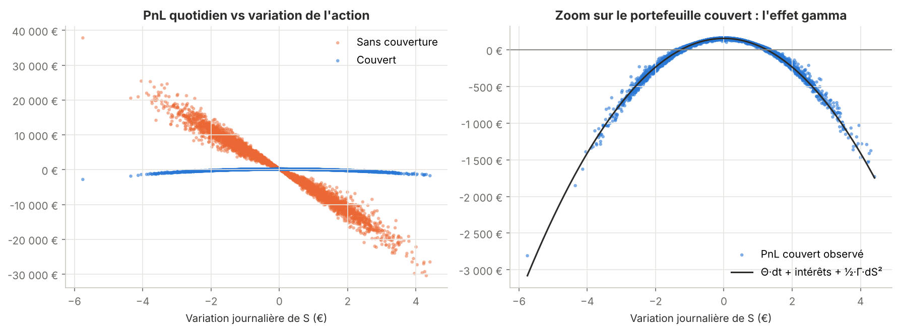
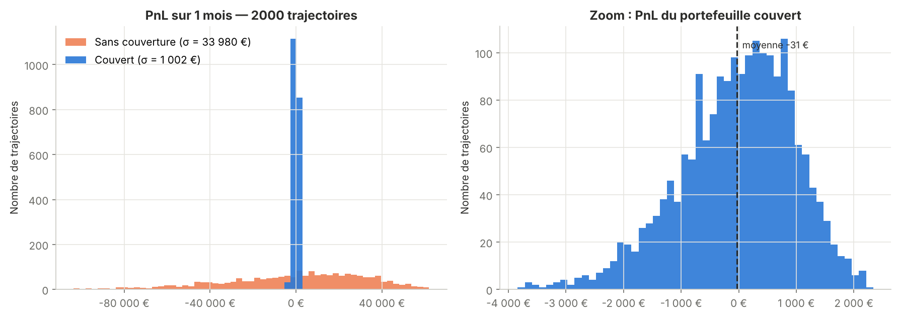
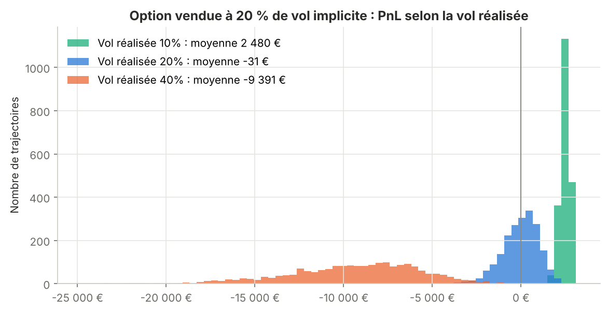
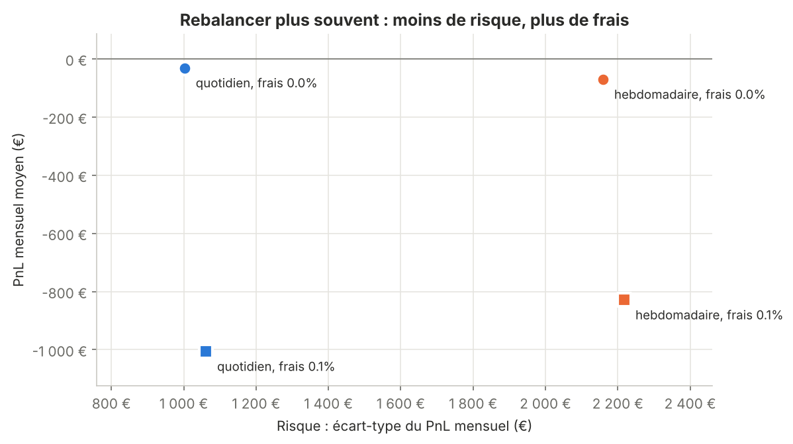

# Couverture delta d'une option sur action — point de vue d'un trader flux

Projet personnel : simulation en Python d'une stratégie de **couverture delta dynamique** d'un call européen vendu à un client, avec un suivi quotidien du PnL, de son attribution par les Grecs et des mesures de risque.

 

---

## Sommaire

1. [Le contexte ](#1-le-contexte)
2. [Hypothèses](#2-hypothèses)
3. [La méthode](#3-la-méthode)
4. [Organisation du code](#4-organisation-du-code)
5. [Lancer le projet](#5-lancer-le-projet)
6. [Résultats](#6-résultats)
7. [Ce qu'il faut retenir](#7-ce-quil-faut-retenir)
8. [Limites et pistes d'amélioration](#8-limites-et-pistes-damélioration)

---

## 1. Le contexte en deux minutes

Un **trader flux** (*flow trader*) travaille dans une banque et répond aux demandes des clients. Il n'est pas là pour parier sur la hausse ou la baisse du marché : il veut encaisser sa marge et dormir tranquille.

Ici, un client **achète** à la banque un call à la monnaie (ATM) d'un an sur une action à 100 €. La banque est donc **vendeuse** de l'option : si l'action monte, elle perd de l'argent.

Pour neutraliser ce risque, le trader **achète des actions**. Combien ? Exactement le **delta** (Δ) de l'option par option vendue. Le delta mesure de combien le prix de l'option bouge quand l'action bouge de 1 € : avec Δ = 0,58, l'option gagne environ 0,58 € quand l'action monte de 1 €. Si on détient 0,58 action par option vendue, les deux mouvements se compensent.

Le problème : **le delta change tout le temps** (avec le prix, le temps, la volatilité). Il faut donc réajuster la couverture chaque jour. C'est ce qu'on simule ici sur un mois.

## 2. Hypothèses

| Paramètre | Valeur |
|---|---|
| Prix initial de l'action S₀ | 100 € |
| Volatilité σ | 20 % |
| Taux sans risque r | 2 % (composé en continu) |
| Dividendes | aucun |
| Option | call européen, K = 100 (ATM), maturité 1 an |
| Taille | 100 contrats × 100 actions = **10 000 actions notionnelles** |
| Horizon simulé | 21 jours de bourse (1 mois), Δt = 1/252 |
| Modèle | Black-Scholes |
| Frais | aucun (sauf dans l'étude des frais : 0,1 % par transaction) |

## 3. La méthode

### 3.1 Prix et Grecs (Black-Scholes)

$$d_1 = \frac{\ln(S/K) + (r + \sigma^2/2)\,T}{\sigma\sqrt{T}}, \qquad d_2 = d_1 - \sigma\sqrt{T}$$

| Grandeur | Formule | Ce qu'elle mesure |
|---|---|---|
| Prix | $C = S\, N(d_1) - K e^{-rT} N(d_2)$ | valeur de l'option |
| Delta | $\Delta = N(d_1)$ | sensibilité au prix de l'action |
| Gamma | $\Gamma = \dfrac{n(d_1)}{S\sigma\sqrt{T}}$ | vitesse à laquelle le delta change |
| Vega | $\nu = S\sqrt{T}\,n(d_1)$ | sensibilité à la volatilité |
| Theta | $\Theta = -\dfrac{S\,n(d_1)\,\sigma}{2\sqrt{T}} - rKe^{-rT}N(d_2)$ | perte de valeur avec le temps |

Au jour 0 : **C = 8,9160 €**, **Δ = 0,5793**, Γ = 0,0196, ν = 39,10. La banque encaisse donc 89 160 € de prime et achète 5 793 actions.

### 3.2 Simulation des prix

Mouvement brownien géométrique (le modèle standard des prix d'actions) :

$$S_t = S_{t-1}\, \exp\left[\left(r - \tfrac{\sigma^2}{2}\right)\Delta t + \sigma\sqrt{\Delta t}\, Z_t\right], \qquad Z_t \sim \mathcal{N}(0,1)$$

### 3.3 La boucle de couverture

Le portefeuille du trader contient trois lignes : l'option vendue, les actions de couverture, et un compte cash (prime encaissée − actions achetées, rémunéré au taux r).

```
Jour 0 : on vend l'option, on encaisse la prime, on achète Δ₀ × 10 000 actions. 
Jour t : nouveau prix S_t
         -> on réévalue l'option (prix et Grecs)
         -> on calcule le PnL de la journée
         -> on ajuste le nombre d'actions au nouveau delta
```

PnL d'une journée (point de vue de la banque vendeuse) :

$$\text{PnL}_t = \underbrace{-N\,(C_t - C_{t-1})}_{\text{option}} + \underbrace{h_{t-1}\,(S_t - S_{t-1})}_{\text{actions}} + \underbrace{B_{t-1}\,(e^{r\Delta t}-1)}_{\text{intérêts}} - \text{frais}_t$$

avec $h_t = N\,\Delta_t$ le nombre d'actions détenues et $B_t$ le cash. Les intérêts sont composés en continu ($e^{r\Delta t}-1$) plutôt qu'en $r\,\Delta t$ : la différence est négligeable sur un jour.

### 3.4 Attribution du PnL par les Grecs

Pour comprendre **d'où vient** le PnL, on le décompose avec un développement de Taylor :

$$\text{PnL}_t \approx \underbrace{\Delta_{\text{net}}\, dS}_{\approx 0 \text{ si couvert}} -\underbrace{\tfrac{1}{2} N\,\Gamma\, dS^2}_{\text{coût gamma}} -\underbrace{N\,\Theta\, dt}_{\text{gain theta}} + \text{intérêts} - \text{frais} + \text{résidu}$$

C'est l'idée centrale du projet: un vendeur d'option couvert **gagne le theta** chaque jour (le temps qui passe fait baisser la valeur de ce qu'il doit) mais **paie le gamma** à chaque mouvement de l'action, petit ou grand. Les deux s'équilibrent exactement quand la volatilité réalisée est égale à la volatilité implicite.

## 4. Organisation du code

```
delta-hedging-equity-option/
├── main.py                     # lance toutes les analyses, écrit results/ et figures/
├── delta_hedging/
│   ├── config.py               # tous les paramètres (dataclasses) 
│   ├── black_scholes.py        # prix + Grecs, cas limites S -> 0 et T -> 0
│   ├── simulation.py           # trajectoires de prix (GBM)
│   ├── hedging.py              # boucle de couverture + décomposition du PnL
│   ├── analytics.py            # PnL total, efficacité de la couverture
│   ├── scenarios.py            # comparaisons : volatilité, frais, fréquence
│   └── plots.py                # graphiques
├── tests/                      # 18 tests automatiques (pytest)
├── results/                    # tableaux CSV générés
└── figures/                    # graphiques générés
```

Quelques choix :

- **Tout est vectorisé avec numpy** : la même fonction traite 1 ou 5 000 trajectoires d'un coup. 5 trajectoires × 21 jours prennent environ **1 ms**.
- **Volatilité implicite et réalisée séparées** : le trader price et couvre avec la vol implicite (celle qu'il connaît), alors que les prix sont simulés avec la vol réalisée. C'est ce qui permet d'étudier le vrai risque du métier.
- **Cas limites** : le prix de l'action ne peut pas descendre sous un plancher de 0,01 €, pour éviter de calculer `log(0)`. Le jour de l'échéance, l'option vaut sa valeur intrinsèque, max(S − K, 0). 

Les tests vérifient entre autres : le prix de référence, la parité call-put, les Grecs contre des différences finies, les cas limites, que la décomposition du PnL tombe juste au centime près, et que la couverture réduit bien le risque.

## 5. Lancer le projet

```bash
git clone https://github.com/tagali-olivier/delta-hedging-equity-option.git
cd delta-hedging-equity-option
pip install -r requirements.txt

python main.py           # toutes les analyses (quelques secondes)
python -m pytest -q      # les tests
```

Options : `python main.py --mc-paths 5000 --seed 7`.

Utiliser les briques séparément :

```python
from delta_hedging.config import MarketParams, OptionSpec, SimulationParams, HedgeParams
from delta_hedging.scenarios import run_scenario

res = run_scenario(MarketParams(), OptionSpec(), SimulationParams(n_paths=5), HedgeParams())
res.to_dataframe(0)      # journal jour par jour de la trajectoire 0
```

## 6. Résultats

Toutes les sorties sont dans [`results/`](results/) (la sortie console complète est dans [`results/sortie_console.txt`](results/sortie_console.txt)). Graine aléatoire : 42.

### 6.1 Cinq trajectoires, couverture quotidienne



| Trajectoire | S final | Vol réalisée | PnL couvert | PnL sans couverture | dont gamma | dont theta |
|---|---|---|---|---|---|---|
| 0 | 98,94 | 17,0 % | **+1 049 €** | +10 272 € | −2 254 € | +4 082 € |
| 1 | 104,72 | 15,8 % | **+1 247 €** | −25 083 € | −2 080 € | +4 182 € |
| 2 | 99,05 | 15,6 % | **+1 395 €** | +9 658 € | −1 922 € | +4 160 € |
| 3 | 98,80 | 13,2 % | **+1 954 €** | +11 035 € | −1 366 € | +4 153 € |
| 4 | 92,99 | 16,4 % | **+917 €** | +39 447 € | −2 297 € | +3 954 € |

**Lecture :**

- **Sans couverture**, le résultat dépend entièrement de la direction du marché : −25 000 € quand l'action monte de 5 % (trajectoire 1), +39 000 € quand elle baisse de 7 % (trajectoire 4). C'est un pari, pas du market-making.
- **Avec couverture**, le PnL reste entre +900 € et +2 000 € quelle que soit la direction. L'efficacité de la couverture est de **99,9 %** : elle élimine 99,9 % de la variance du PnL quotidien.
- Les cinq PnL sont positifs, et ce n'est pas un hasard: avec cette graine, les cinq trajectoires ont une **vol réalisée inférieure à 20 %**. Le trader a vendu de la volatilité à 20 % et le marché n'a bougé qu'à 13–17 %, donc le gain theta dépasse le coût gamma. Plus la vol réalisée est basse, plus le PnL est élevé (trajectoire 3 : 13 % → +1 954 €).



Les intérêts sont négatifs car le trader emprunte pour acheter les actions (≈ 579 000 € d'actions contre 89 000 € de prime). Le résidu <<inexpliqué >> est quasi nul (−10 € sur la trajectoire 0) : l'attribution par les Grecs explique tout le PnL.

### 6.2 L'effet gamma, en une image



À gauche, l'option seule : une droite, on perd quand l'action monte. À droite, le portefeuille couvert : une **parabole retournée**. Les petits mouvements rapportent un peu (le theta, ≈ +156 € par jour net des intérêts), les grands mouvements coûtent cher, **dans les deux sens**. C'est la signature d'une position **gamma négatif**. La courbe noire est la formule théorique Θ·dt + ½·Γ·dS² : elle colle aux points simulés.

### 6.3 Monte-Carlo : 2 000 trajectoires



| | Couvert | Sans couverture |
|---|---|---|
| PnL moyen sur 1 mois | −31 € | −439 € |
| Écart-type | **1 003 €** | 33 989 € |

La couverture divise le risque par **34**. En moyenne, le PnL couvert est proche de zéro, comme le prédit la théorie : quand vol réalisée = vol implicite, gain theta et coût gamma se compensent. Le petit −31 € vient de la discrétisation (on rebalance une fois par jour, pas en continu).

### 6.4 Robustesse : σ = 10 %, 20 %, 40 %

D'abord le cas où vol implicite et vol réalisée sont égales :

| σ | PnL moyen | Écart-type couvert | Écart-type sans couverture | Gamma moyen | Theta moyen | Efficacité |
|---|---|---|---|---|---|---|
| 10 % | −15 € | 496 € | 17 496 € | −1 629 € | +2 528 € | 99,92 % |
| 20 % | −31 € | 1 003 € | 33 989 € | −3 295 € | +4 080 € | 99,91 % |
| 40 % | −64 € | 1 985 € | 70 669 € | −6 521 € | +7 171 € | 99,92 % |

**Oui, le PnL se stabilise** : il reste centré sur zéro, et l'efficacité est la même (≈ 99,9 %) quel que soit le niveau de vol. Le risque résiduel augmente à peu près proportionnellement à σ, comme le risque sans couverture.

Mais le vrai danger est ailleurs : quand **la vol réalisée n'est pas celle qu'on a vendue**. Option vendue à 20 % :



| Vol réalisée | PnL moyen | Écart-type | Gamma moyen | Theta moyen |
|---|---|---|---|---|
| 10 % | **+2 480 €** | 258 € | −836 € | +4 131 € |
| 20 % | −31 € | 1 003 € | −3 295 € | +4 080 € |
| 40 % | **−9 391 €** | 3 716 € | −12 508 € | +3 900 € |

Le theta encaissé est presque le même dans les trois cas (il est fixé par la vol implicite de 20 %). C'est le **coût gamma** qui explose quand le marché s'agite : il est multiplié par 15 entre 10 % et 40 % de vol réalisée. La couverture delta protège contre la **direction** du marché, pas contre son **agitation**.

### 6.5 Frais de transaction et fréquence de rebalancement



| Rebalancement | Frais | PnL moyen | Écart-type | Frais payés |
|---|---|---|---|---|
| quotidien | 0 % | −31 € | 1 003 € | 0 € |
| quotidien | 0,1 % | −1 006 € | 1 062 € | −974 € |
| hebdomadaire | 0 % | −71 € | 2 160 € | 0 € |
| hebdomadaire | 0,1 % | −829 € | 2 218 € | −757 € |

**Le compromis :**

- Rebalancer **chaque semaine** au lieu de chaque jour **double le risque** (écart-type de 1 003 € à 2 160 €), car le delta dérive pendant 5 jours sans être corrigé.
- En échange, on économise environ **220 € de frais** par mois. Pas énorme, car la plus grosse partie des frais (≈ 579 €) est payée au jour 0, à l'achat initial des 5 793 actions, quelle que soit la fréquence.
- Ici, le rebalancement quotidien est clairement le meilleur choix : doubler le risque pour 220 € d'économie ne vaut pas le coup. Avec des frais plus élevés ou un sous-jacent moins liquide, le point d'équilibre se déplacerait vers des rebalancements moins fréquents, ou vers des règles du type « rebalancer seulement quand le delta net dépasse un seuil ».

## 7. Ce qu'il faut retenir

1. **Le delta est le bouclier** : la couverture élimine plus de 99,9 % du risque lié à la direction du marché.
2. **Le gamma est la fuite** : un vendeur d'option couvert perd de l'argent à chaque mouvement de l'action, petit ou grand. Les grands sauts coûtent très cher, car le coût est proportionnel à dS².
3. **Le theta paie la facture** : en échange, le temps qui passe lui rapporte chaque jour.
4. **Le vrai pari est sur la volatilité** : un trader delta-neutre gagne si le marché bouge moins que la volatilité implicite qu'il a vendue, et perd s'il bouge plus. Le PnL du mois tient à peu près dans la formule $\tfrac{1}{2}\,\Gamma S^2 (\sigma_{\text{implicite}}^2 - \sigma_{\text{réalisée}}^2)\,dt$ sommée sur les jours.
5. **Rebalancer a un coût** : plus souvent, c'est moins de risque mais plus de frais.

**En une phrase :** *« Une position delta-neutre courte en options est courte gamma et longue theta : elle gagne si la volatilité réalisée est inférieure à la volatilité implicite, et c'est le coût gamma qui domine sur un marché agité. »*

## 8. Limites et pistes d'amélioration

- **Volatilité constante** : dans la réalité, la vol implicite bouge, ce qui crée un PnL vega (ici nul par construction). Piste : simuler une vol implicite stochastique et ajouter le terme ν·dσ à l'attribution.
- **Pas de sauts** : le GBM ne produit pas de krachs. Un modèle à sauts (Merton) montrerait des pertes gamma bien plus brutales.
- **Couverture gamma** : on pourrait neutraliser aussi le gamma en achetant une autre option, puis couvrir le delta résiduel avec l'action.
- **Règles de rebalancement plus fines** : seuil sur le delta net, bandes de Whalley-Wilmott.
- **Données réelles** : rejouer la stratégie sur l'historique d'Apple ou du S&P 500.
